

  

I'm Fotis. I run a small studio called **423** from Kefalonia, Greece. I build my own apps and websites, and more and more of them are written in **Rust**. A team of AI agents (seven cats, led by my real cat Ross) helps me run everything.

## Apps

<table>
  <tr>
    <td width="96" align="center">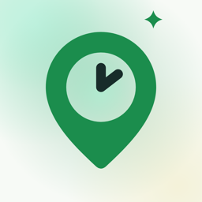</td>
    <td><b><a href="https://locit.gr">Locit</a></b> Book local services in Kefalonia: massage, hair, nails, spa and more, from small local businesses. Website and phone app, moving to a Rust server.</td>
  </tr>
  <tr>
    <td align="center">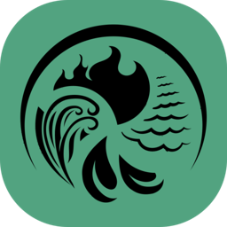</td>
    <td><b><a href="https://massage4kefalonia.com">4 Elements Massage</a></b> Website, booking and reminders for our massage studio in Kefalonia. Rewritten in Rust (Axum + Leptos) and live.</td>
  </tr>
</table>

## Tools we built

<table>
  <tr>
    <td width="96" align="center">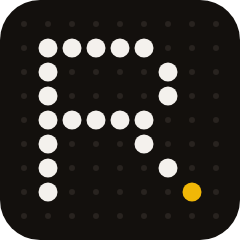</td>
    <td><b>Rust rewrite method</b> Our way to move a live app to Rust with nothing breaking: record every real answer and outgoing call of the old app, replay them against the new one, compare screenshots pixel by pixel, then switch over with a one-step rollback. 4 Elements went live this way; Locit is next.</td>
  </tr>
  <tr>
    <td align="center">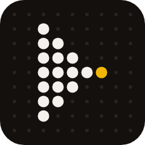</td>
    <td><b>AI video ad studio</b> One short line in, a finished ad out: concepts to pick from, script and shot list, AI-generated footage (Seedance), motion graphics (Remotion) and 3D (Blender), with real costs shown before anything is spent.</td>
  </tr>
  <tr>
    <td align="center">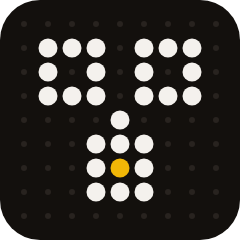</td>
    <td><b>One setup, three machines</b> The same rules, skills and AI-agent settings on my server, desktop and home NAS, kept in one place and synced with a single command.</td>
  </tr>
  <tr>
    <td align="center">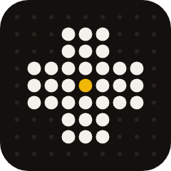</td>
    <td><b>Self-healing Locit</b> A watchdog that brings the app back if it stops, nightly backups, and a restore test that proves the backups actually work.</td>
  </tr>
</table>

## The cat team

AI agents that run on Orca with Claude. Each one has a job, checks it every morning and reports to Ross. They only look and report; changes happen after I say yes.

<table>
  <tr>
    <td align="center" valign="top" width="14%">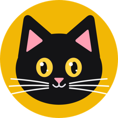 <b>Ross</b> The boss. Morning brief, weekly review, hands out the work.</td>
    <td align="center" valign="top" width="14%">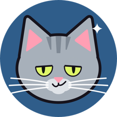 <b>Makis</b> Security checks.</td>
    <td align="center" valign="top" width="14%">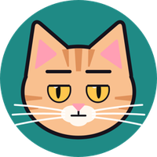 <b>Babi</b> Updates and new AI tools.</td>
    <td align="center" valign="top" width="14%"> <b>Argiris</b> Backups, with a test restore every week.</td>
    <td align="center" valign="top" width="14%">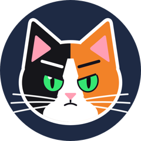 <b>Freya</b> Locit, 4 Elements and SEO.</td>
    <td align="center" valign="top" width="14%"> <b>Peri</b> Home media server.</td>
    <td align="center" valign="top" width="14%">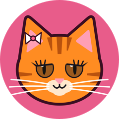 <b>Eevee</b> Design and new ideas.</td>
  </tr>
</table>

## What I build with

- **Rust** for new servers and pages: Axum, Leptos, sqlx
- **Expo / React Native** for phone apps
- **Claude Code** and **Orca** for the AI agents
- **Docker**, **Cloudflare** tunnels, **n8n** automations
- **Blender** and AI video for 3D and ads

## Where to find me

[locit.gr](https://locit.gr) · [massage4kefalonia.com](https://massage4kefalonia.com) · Kefalonia, Greece
